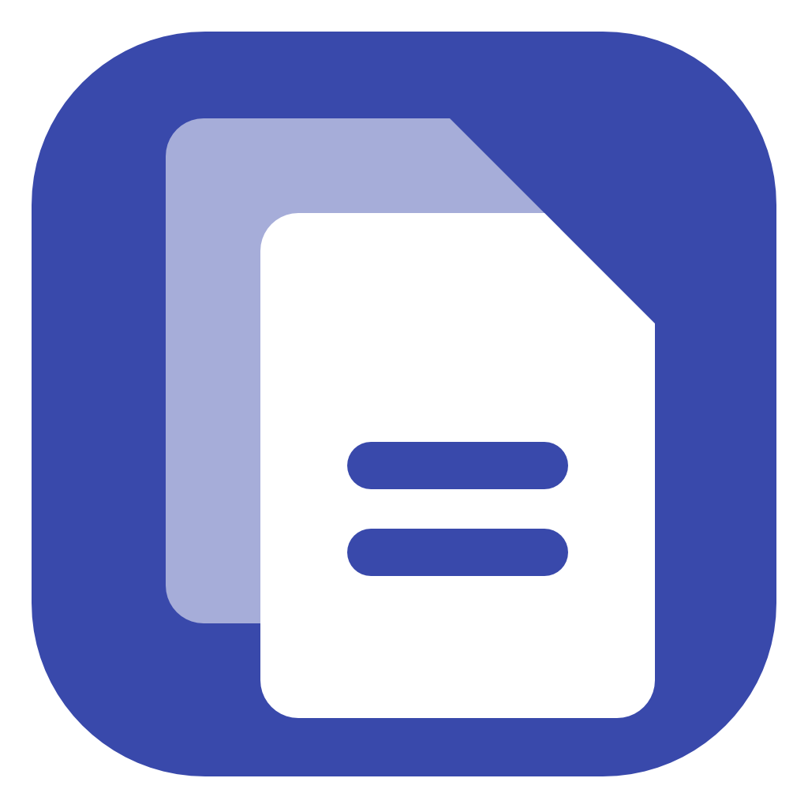
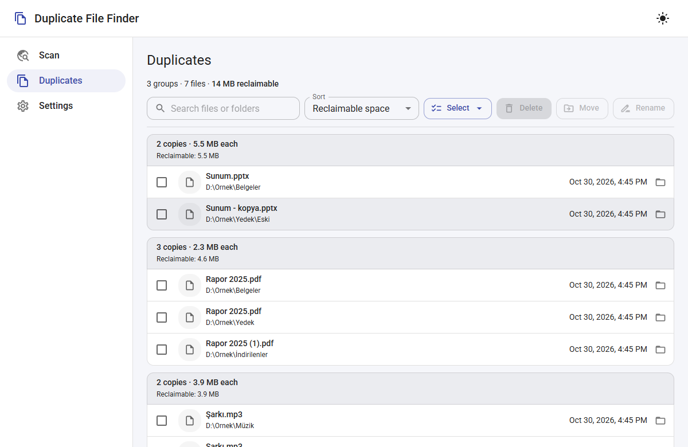
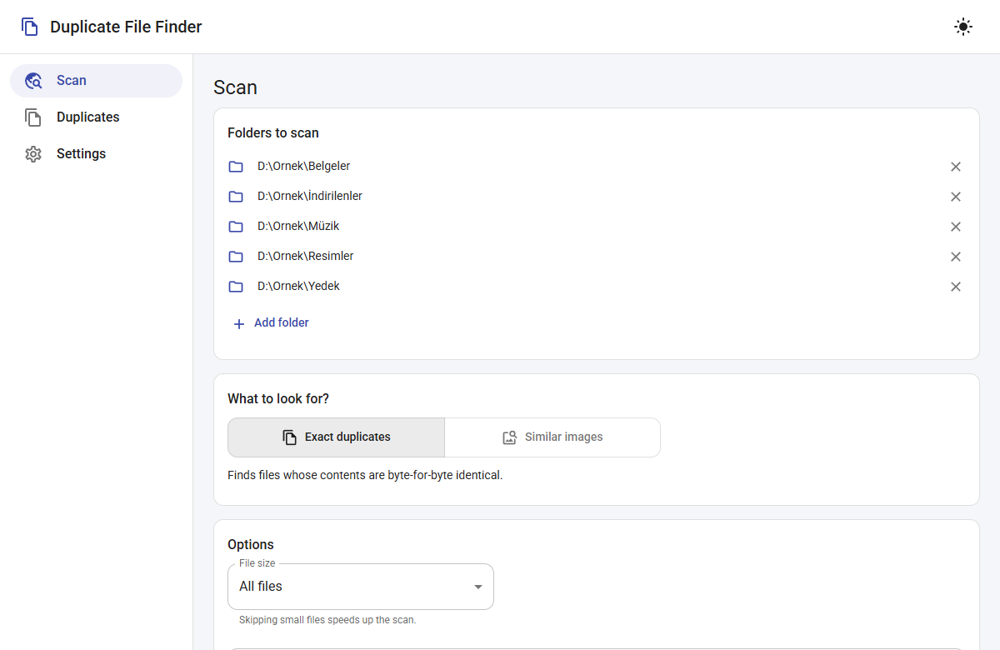
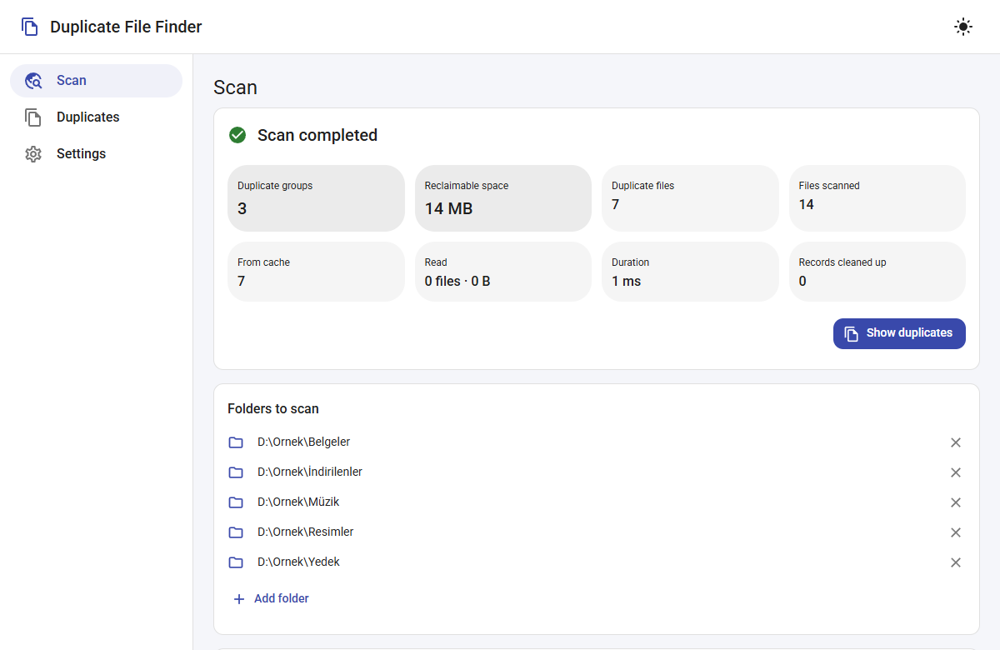
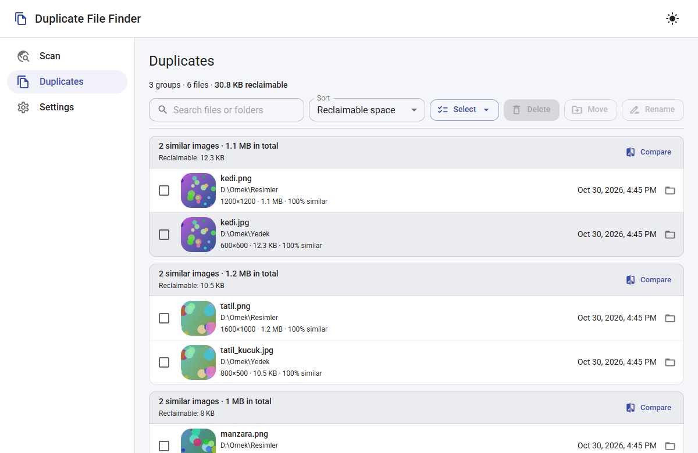
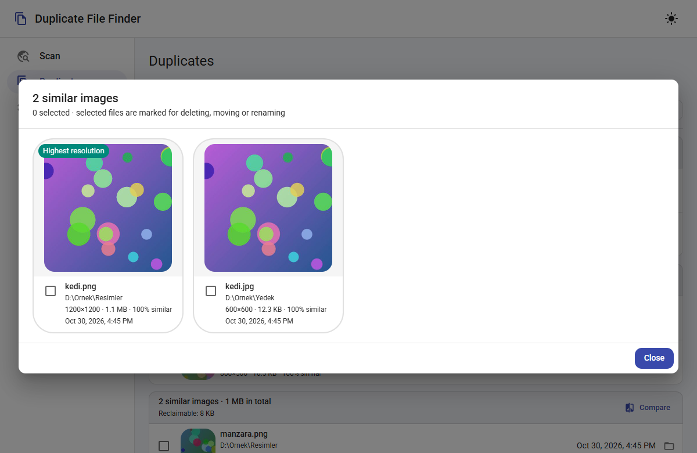
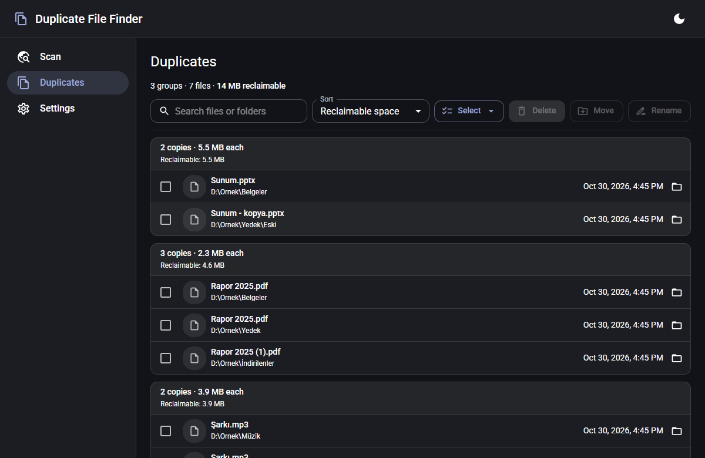
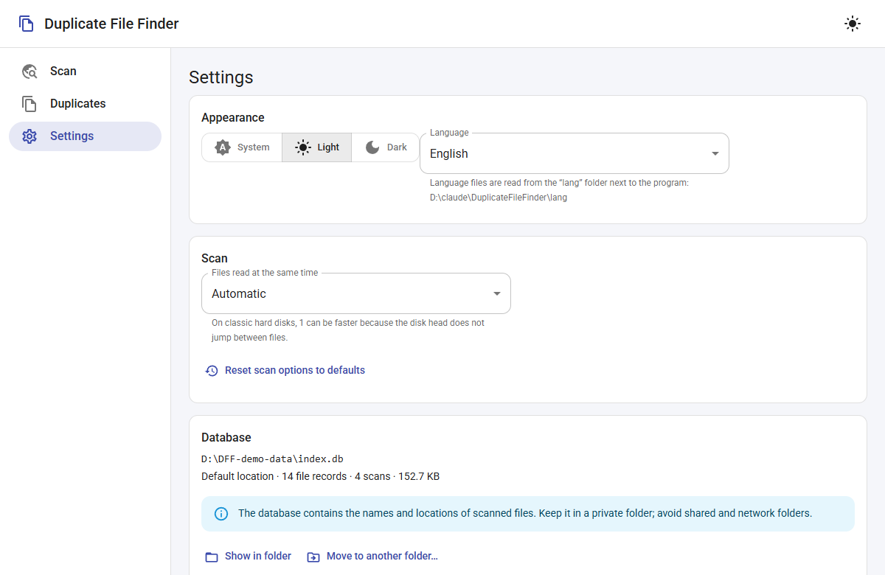

<div align="center">



# Duplicate File Finder

[Türkçe](README.md) · **English**

Duplicate and similar file finder for Windows and macOS.

[](https://github.com/fatih-turkoglu/DuplicateFileFinder/releases/latest)
[](https://github.com/fatih-turkoglu/DuplicateFileFinder/releases)



</div>

Scans folders, groups files with byte-identical content or photos that look alike,
and lets you safely delete, move or rename the ones you select.

- **Exact duplicates:** compared by size → start and end of the file → whole file
  (xxh3), in that order; only as much as needed is read.
- **Similar images:** resized, recompressed or lightly edited photos are found with
  a perceptual hash (dHash).
- **Fast rescans:** information about scanned files is kept in a database;
  unchanged files are not read again on the next scan.
- **Last-copy protection:** all files of a group are never deleted; by default,
  deletion sends files to the Recycle Bin / Trash.
- Light/dark theme, responsive Material interface.
- Multilingual: Turkish, English, German, French, Portuguese, Romanian, Bulgarian
  (chosen automatically from the system language; more can be added with language files).

## Download

| Platform | File | |
|---|---|---|
| Windows 10/11 (64-bit) | `DuplicateFileFinder-windows-amd64.zip` | [⬇ Download ZIP](https://github.com/fatih-turkoglu/DuplicateFileFinder/releases/latest/download/DuplicateFileFinder-windows-amd64.zip) |
| macOS 13+ (Apple Silicon + Intel) | `DuplicateFileFinder-macos-universal.zip` | [⬇ Download ZIP](https://github.com/fatih-turkoglu/DuplicateFileFinder/releases/latest/download/DuplicateFileFinder-macos-universal.zip) |

- All versions and release notes: **[Releases](https://github.com/fatih-turkoglu/DuplicateFileFinder/releases)**
- Source code: [download as ZIP](https://github.com/fatih-turkoglu/DuplicateFileFinder/archive/refs/heads/main.zip)
  or `git clone https://github.com/fatih-turkoglu/DuplicateFileFinder.git`
- Each archive comes with a `.sha256` checksum. To verify: on Windows
  `Get-FileHash DuplicateFileFinder-windows-amd64.zip`, on macOS
  `shasum -a 256 -c DuplicateFileFinder-macos-universal.zip.sha256`.

See [Windows installation](#windows-installation) and [macOS installation](#macos-installation) for details.

## Screenshots

| | |
|---|---|
|  |  |
| **Scan** — choose folders and what to look for | **Summary** — reclaimable space and scan statistics |
|  |  |
| **Similar images** — thumbnail, resolution and similarity | **Compare** — side by side with large previews |
|  |  |
| **Dark theme** | **Settings** — theme, language, database and maintenance |

---

## Usage

### macOS installation

- **macOS 13 Ventura or later.** Apple Silicon (M series) and Intel are supported;
  the Universal package contains both. The minimum version comes from the
  [Go 1.27 requirements](https://go.dev/wiki/MinimumRequirements).
- Unzip, drag **DuplicateFileFinder.app** into **Applications** and open it.
  Language files are inside the app; there is no separate `lang` folder to move.
- WKWebView ships with macOS; WebView2 is not needed.
- Local builds are ad hoc signed. A package distributed to other computers needs an
  Apple Developer ID signature and notarization; a local signature does not replace Apple’s approval.
- macOS may ask for permission to access the Desktop, Documents, Downloads, an external
  disk or a network folder you choose. Folders are picked with the system’s own dialog.
- The reveal button works as **Show in Finder** and the default delete as **Move to Trash**.
  If moving to the Trash fails, the file is not deleted permanently.
- The Mac system font, a draggable unified title bar, standard window buttons, native
  application/Edit menus and the **⌘C / ⌘V / ⌘X / ⌘Z / ⌘A / ⌘Q** shortcuts are used.

### Windows installation

No installation needed: put `DuplicateFileFinder.exe` and the `lang` folder next to it
in any folder and run it (it also works without `lang`; the interface is then in English).

- Windows 10 or 11 (64-bit).
- Microsoft Edge WebView2 Runtime. It is already installed on Windows 11 and up-to-date
  Windows 10; otherwise the app offers to download it on first launch.

### Scanning

1. On the **Scan** page, choose one or more folders with **Add folder**.
   Duplicates across folders are found as well.
2. **What to look for?** — *Exact duplicates* or *Similar images*.
   For similar images, the **similarity threshold** can be adjusted (lower = stricter).
3. Optionally change the options for file size, file types, hidden files and
   excluded folders. Options are remembered for the next launch.
4. **Start scan.** You can switch to other pages during the scan.
   If you press **Stop**, everything computed so far is saved; the next scan
   quickly continues where it left off.

### Reviewing duplicates and taking action

On the **Duplicates** page, each group is listed as a card.

- Tick files one by one or use the **Select** menu:
  *Keep newest*, *Keep oldest*, *Keep highest resolution* (similar images),
  *Select duplicates in folder*. These helpers never select every file of a group.
- In similar-image groups, **Compare** shows the images side by side with large previews.
- The folder icon reveals the file in **Finder** (macOS) or **Explorer** (Windows).
- For the selected files:
  - **Delete** — sends them to the **Recycle Bin** by default; permanent deletion
    must be ticked separately.
  - **Move** — if a file with the same name exists at the destination, it is given
    a new name or skipped.
  - **Rename** — a new name for a single file; for several files, a `{name}`,
    `{ext}`, `{n}` template with a preview.

### Safety

- **Scan scope:** scans covering the whole disk, such as `/`, can include system and
  application files in the results. Identical content does not mean a file is
  unnecessary; different applications may need their own copies. Limit bulk cleanups
  to personal folders such as Desktop, Documents, Downloads and Pictures; do not delete
  files in `.app/Contents` or system folders just because they appear as duplicates.
  On macOS, with **Skip hidden and system files** on, known system folders, the user
  Library folder and application/library packages are excluded from the scan; on
  Windows the same option skips system folders such as `Windows`, `Program Files`,
  `ProgramData`, `$Recycle.Bin` and the user `AppData` folder (except Temp). This
  protection does not recognize every possible application data file; scanning
  personal folders only is recommended.
- **Mac application protection:** known system paths and the contents of packages such
  as `.app`, `.framework`, `.bundle` and the Photos library cannot be deleted, moved or
  renamed, even when selected from old scan results. These locations do not count as a
  backup of a personal file for last-copy protection. Different paths leading to the
  same physical file are not accepted as an independent backup either.
- **Windows system protection:** files in the Windows system folders above and under
  `AppData` likewise cannot be deleted, moved or renamed, and nothing can be moved into
  these folders. Junctions and symbolic links are resolved before checking.
- **Last-copy protection:** a file is **not deleted** unless a counterpart that is still
  unchanged on disk remains (an exact copy, or for similar images a match within the
  threshold). Even if all files of a group are selected, not all of them can be deleted.
- No operation ever overwrites an existing file.
- On drives without a Recycle Bin (network drive, USB stick), files are not silently
  deleted permanently; the app asks first.
- When moving to another drive, the file is copied and verified first, then the source is deleted.

### Settings

- Theme (system / light / dark).
- **Files read at the same time:** on classic hard disks (HDD), **1** can be faster.
- **Database:** view its location, move it to another folder (e.g. another drive),
  restore the default.
- **Maintenance:** compact, clean up records of files no longer on disk, clear the
  cache completely. None of these touch your files.

### Language

On Windows, interface languages are read from the **`lang`** folder next to the exe:

```
DuplicateFileFinder.exe
lang\
  tr.lng  de.lng  fr.lng  pt.lng  ro.lng  bg.lng  en.lng
```

- The language is chosen **automatically** from the operating system’s language order
  (on macOS: System Settings → Language & Region). It can also be set manually under
  Settings → Appearance → **Language**.
- If the `lang` folder is missing or empty, the app runs in **English** (English is built in).
- If a text is missing from a language file, it is shown in English.
- To add a language: copy `en.lng`, name it with the language code (e.g. `it.lng`),
  translate `@name`, `@locale` and the texts, and put it in the `lang` folder.
  The format is described at the top of `en.lng`.

The translations (other than Turkish) have not been reviewed by native speakers.

On macOS, translations live in `DuplicateFileFinder.app/Contents/Resources/lang`. Since
changing the contents of a signed app breaks its signature, use a separate folder via
`DUPLICATEFILE_LANG_DIR` for custom translations.

### Data locations

macOS:

| What | Where |
|---|---|
| Database | `~/Library/Application Support/DuplicateFile/index.db` (can be moved in Settings) |
| Settings file | `~/Library/Application Support/DuplicateFile/config.json` |
| WKWebView preferences | `~/Library/WebKit/com.duplicatefile.app` and `~/Library/Preferences/com.duplicatefile.app.plist` |

The database and settings are kept in the persistent application data folder rather
than `Library/Caches`, which the system may purge.

Windows:

| What | Where |
|---|---|
| Database (cache) | `%LOCALAPPDATA%\DuplicateFile\index.db` (can be moved in Settings) |
| Settings file | `%LOCALAPPDATA%\DuplicateFile\config.json` |
| Interface preferences (theme, scan options) | WebView2 profile: `%APPDATA%\DuplicateFileFinder.exe\` |

If the `DUPLICATEFILE_DATA_DIR` environment variable is set, the database and settings
file are kept in that folder (for portable use and tests).

If `DUPLICATEFILE_LANG_DIR` is set, language files are read from that folder instead of
the default location. Both variables are accepted only as **absolute paths**; relative
values are ignored. The value used or ignored is written to the application log.

To uninstall completely, delete the `.app` / `.exe` (on Windows also the `lang` folder
next to it) and the platform’s data folders listed above.

### Known limitations

- **HEIC** (iPhone photos) is not supported; similar-image scans cover JPG, PNG, GIF,
  BMP, TIFF and WebP.
- **EXIF orientation** is ignored: a photo the phone rotated only via the tag may not
  match a copy that was actually rotated.
- Similar-image grouping compares all pairs; it may slow down on very large libraries
  (100,000+ images).
- When the app is reopened, only exact-duplicate results are loaded from the database;
  similar-image results require a new scan.

---

## Development

Go + [Wails v2](https://wails.io) backend, React + TypeScript + [MUI](https://mui.com) interface,
SQLite (pure Go, `modernc.org/sqlite`). The desktop shell and the native macOS Foundation bridge use CGO.

### macOS development

Requirements: **Go 1.27.3+**, **Node.js 22.13+** (24 LTS recommended), npm and the Xcode
Command Line Tools. Development tools may live in the user environment or under
`.tools/go`, `.tools/bin`; system settings are not changed.

```bash
xcode-select --install  # once, if the tools are not installed
source ./env.sh
go install github.com/wailsapp/wails/v2/cmd/wails@v2.17.0
wails dev
```

`env.sh` can be sourced from Bash and zsh. It keeps the Go/npm caches inside the project
and makes development read language files directly from the `lang/` folder.

```bash
./build.sh                 # this Mac’s architecture, with tests
./build.sh --universal     # Apple Silicon + Intel, single .app
./build.sh --arch amd64    # Intel only
./build.sh --skip-tests    # skip tests
```

Output: **`build/bin/DuplicateFileFinder.app`** and `DuplicateFileFinder-macos-<arch>.zip`
(`universal`, `arm64` or `amd64`).
The script installs the locked npm dependencies, builds the interface, runs Go vet/test,
the interface tests and a `govulncheck` scan; it puts the languages into the package,
signs and verifies the final bundle, and writes a `.sha256` checksum next to the ZIP.
`wails.json` is the single source of the version. Universal builds are made on macOS.
Ad hoc signing is used for local testing only. For distribution:

- `DUPLICATEFILE_SIGN_IDENTITY` — a Developer ID Application identity; signed with the
  hardened runtime and a timestamp.
- `DUPLICATEFILE_NOTARY_PROFILE` — a profile saved with `xcrun notarytool store-credentials`;
  if set, the package is notarized, the ticket is stapled and the ZIP is regenerated.

In a fresh clone, run `cd frontend && npm ci && npm run build` before `go test ./...`;
Go embeds the interface files. `build.sh` does this automatically.

### Windows environment

Tools are not installed system-wide; they live portably in the project’s `.tools\`
folder (Go, Node.js, Wails CLI, Git, caches). In every terminal, first run:

```powershell
. .\env.ps1
```

The leading dot and space matter; run as `.\env.ps1`, the settings do not stay in the terminal.

If Windows blocks the script with *"is not digitally signed"* / `PSSecurityException`
(the default execution policy or the "downloaded from the internet" mark from a zip),
run these first in the same terminal:

```powershell
Set-ExecutionPolicy -Scope Process -ExecutionPolicy Bypass -Force   # this terminal only; no admin needed
Get-ChildItem -Recurse -Filter *.ps1 | Unblock-File                 # removes the zip block mark (once is enough)
. .\env.ps1
```

The first line is needed in every new terminal. To permanently allow local scripts for
your own user only, run `Set-ExecutionPolicy -Scope CurrentUser RemoteSigned` once.
If the error persists, check `Get-ExecutionPolicy -List`: if `MachinePolicy` or
`UserPolicy` is set, the policy comes from Group Policy and cannot be changed with these commands.

This only sets the `PATH` of that terminal session. If `.tools\` does not exist (e.g. a
fresh clone): extract the official Windows **zip** releases of Go 1.27.3+ and Node.js 22.13+
into `.tools\go` and `.tools\node`, optionally Git for Windows **PortableGit** into
`.tools\git`; then run `go install github.com/wailsapp/wails/v2/cmd/wails@v2.17.0`.

### Running and building on Windows

```powershell
wails dev          # live development (interface changes apply instantly)
.\build.ps1        # tests + release build → build\bin\DuplicateFileFinder.exe
```

`build.ps1` runs all tests first; it takes the version from `info.productVersion` in
`wails.json` (the exe properties and the in-app *About* use the same source) and builds
with `-trimpath`. To change the version, only `wails.json` is updated. Interface
dependencies are installed with `npm ci` strictly from `package-lock.json`; Go
dependencies and the toolchain are scanned with `govulncheck`.

`SHA256SUMS.txt` checksums of the exe and language files are written to the output folder
(verify with `sha256sum -c SHA256SUMS.txt` or `Get-FileHash`). For Authenticode signing
for distribution, set `DUPLICATEFILE_SIGN_CERT` to the SHA-1 thumbprint of the code-signing
certificate in the user certificate store (requires `signtool` from the Windows SDK; the
timestamp server can be changed with `DUPLICATEFILE_TIMESTAMP_URL`). Signing happens
before `SHA256SUMS.txt`; the checksums belong to the signed exe.

Finally, the exe and the `lang` folder are packed into
`build\bin\DuplicateFileFinder-windows-amd64.zip`, with a `.sha256` checksum next to it.

### Publishing a release

1. Update `info.productVersion` in `wails.json`.
2. Run `.\build.ps1` on Windows and `./build.sh --universal` on macOS.
3. Create a new GitHub release tagged `v<version>` and attach:
   `DuplicateFileFinder-windows-amd64.zip`, `DuplicateFileFinder-macos-universal.zip`
   and the `.sha256` files of both.

Archive names contain no version number, so the `releases/latest/download/...` links in
[Download](#download) keep working for every new release without changes.

### Tests

```powershell
go test ./...                       # Go unit tests
cd frontend; npm test               # interface logic (node --test)
```

End-to-end tests drive the installed Chrome/Edge with `playwright-core` and connect to
the `wails dev` server (while `wails dev` runs in another terminal):

```powershell
node frontend\e2e\smoke.mjs <folder-to-scan>     # scan, results screen, theme
node frontend\e2e\fileops.mjs                    # delete / move / rename (in a temp folder)
node frontend\e2e\similar.mjs                    # similar images (in a temp folder)
node frontend\e2e\language.mjs with-lang         # language selection and switching (see Language support)

# The settings test clears the cache and moves the database: ONLY with an empty data folder
$env:DUPLICATEFILE_DATA_DIR = "<empty folder>"; wails dev
node frontend\e2e\settings.mjs "<same folder>"
```

On macOS, run the end-to-end tests the same way in a separate terminal:

```bash
# Terminal 1: temporary test data only
source ./env.sh
DUPLICATEFILE_DATA_DIR="$PWD/.tools/e2e-data" wails dev
# Terminal 2
node frontend/e2e/fileops.mjs
node frontend/e2e/similar.mjs
node frontend/e2e/language.mjs with-lang
node frontend/e2e/macos.mjs  # Mac theme, keyboard, Finder/Trash texts
node frontend/e2e/settings.mjs "$PWD/.tools/e2e-data"
```

If Chrome/Edge is not in its standard location, give the full path of the executable with
`DUPLICATEFILE_BROWSER`. Screenshots are written to `e2e-out/`.
The real Trash test runs only on request and leaves a temporary test file in the Trash:
`DUPLICATEFILE_TEST_RECYCLE=1 go test ./internal/fileops -run MacRecycleIntegration`.

The real Windows Recycle Bin test runs only on request:
`$env:DUPLICATEFILE_TEST_RECYCLE = "1"; go test ./internal/fileops -run Recycle`

### Language support (developers)

- English texts live in `frontend/src/i18n/en.ts` (single source). The interface uses
  `t('key', { placeholder: value })`; count-dependent texts get `{ count }` and the
  `.one` / `.few` / `.other` … suffix is chosen by the language’s plural rule.
- When adding a text: add it to `en.ts` → `cd frontend; npm run lang:en` (generates
  `lang/en.lng`) → add its translation to the other `lang/*.lng` files. `npm test` checks
  every file for missing/extra keys, placeholders and plural suffixes.
- macOS-specific texts use the `.mac` suffix (e.g. `file.showInExplorer.mac`, in plurals
  `outcome.recycled.mac.other`); other platforms use the base key.
- Go errors shown in the interface have the form `[code] English description`
  (`internal/apperr`); the interface translates the code with the `error.<code>` key.
- During `wails dev`, language files are read from `build\bin\lang` (copied by `build.ps1`)
  or directly from the source folder with `$env:DUPLICATEFILE_LANG_DIR = "<project>\lang"`.
- End-to-end: `node frontend\e2e\language.mjs no-lang|with-lang` (usage at the top of the file).

### Testing on a clean Windows

`tools\sandbox\DuplicateFile.wsb` opens the app in **Windows Sandbox** (a temporary
Windows that starts fresh every time). The feature must be enabled:
*Turn Windows features on or off → Windows Sandbox* (admin rights, restart).

1. `.\build.ps1`
2. Double-click `tools\sandbox\DuplicateFile.wsb` (networking is disabled).
3. Checklist:
   - The app opens; the window and taskbar icons are correct.
   - Add the `DuplicateFile` folder on the desktop to the scan; the scan completes.
   - Settings → About shows the right version; the database is under `%LOCALAPPDATA%\DuplicateFile`.
   - Create a few duplicates in a folder and delete them to the **Recycle Bin**; the files
     appear in the Recycle Bin.

### Project structure

```
main.go, app.go        Wails application and Go functions exposed to the interface
settings.go            configuration, database moving and maintenance
thumbs.go              /thumb: thumbnail server (asset middleware)
internal/db            SQLite schema, migrations, queries
internal/scanner       scan engine (exact + similar images)
internal/imaging       dHash and thumbnails
internal/fileops       delete / move / rename + last-copy protection
internal/i18n          .lng language files and system language preference
internal/macos         Foundation: Trash, system language and theme
internal/pathutil      platform-appropriate path comparison
internal/appdirs       platform-appropriate persistent data folder
internal/apperr        coded errors sent to the interface
lang/                  language files (build.sh copies into the .app, build.ps1 next to the exe)
cmd/scancli            tool to try and measure the scan engine without the interface
cmd/genicon            draws the application icon (build/appicon.png)
frontend/src           React interface (api.ts: the single connection point to Go)
frontend/e2e           end-to-end tests
```

On macOS scans, the `.Trash`, `.Trashes`, `.Spotlight-V100` and `.fseventsd` folders are
always skipped. Besides dot names, the hidden-file filter also honors Finder’s `hidden`
flag; with the option on, system folders and application packages are skipped too. Case
is preserved in Unix paths; on case-sensitive APFS volumes `Foto` and `foto` are separate
directories. Database migration v3 applies platform-appropriate comparison while keeping
the existing cache.
